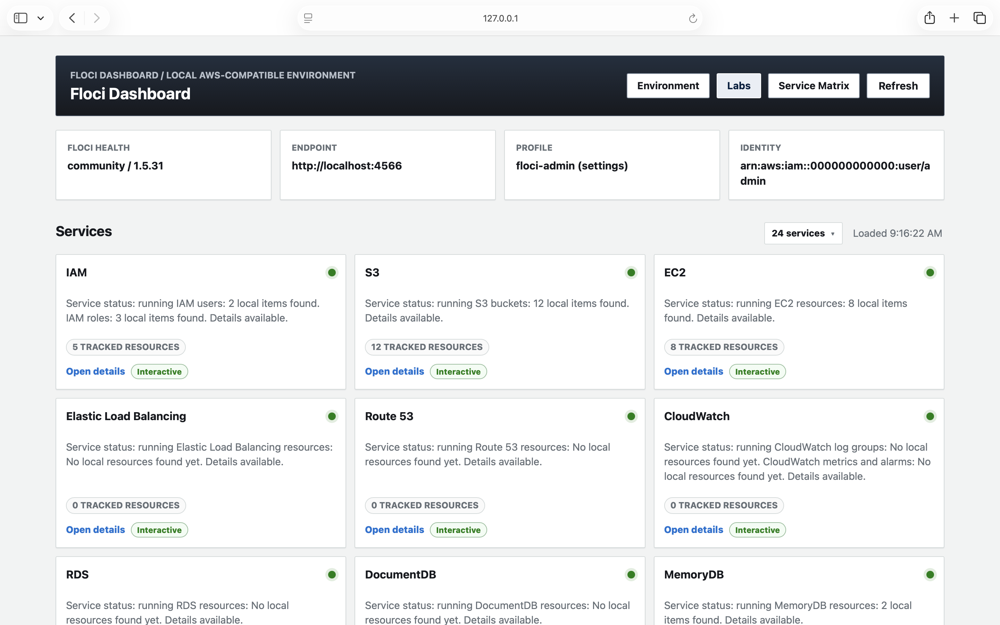

# Floci Dashboard 2.0.2

A local console for inspecting, testing, and learning AWS workflows with [Floci](https://floci.io/). Built with Django, React, TypeScript, Vite, and AWS’s Cloudscape design system.

The dashboard catalogs **65 AWS services** and includes **78 workflow labs across 25 services, with 484 steps**. Compatibility checks target Floci 2.3.0; Floci supports additional services beyond this dashboard’s catalog. This is a local development and learning tool, not the AWS Management Console.



## Features

- **Service consoles:** dedicated interfaces for core services, plus shared resource inventories and schema-driven operation forms. The registry marks 60 services as interactive workbenches; available actions vary by service and emulator support.
- **Resource navigation:** searchable service catalog, favorites, recently visited services, sortable resource tables, pagination, column preferences, and resource details.
- **Operational views:** EC2 networking and security details, CloudWatch metric charts and log-stream browsing, REST/HTTP API Gateway inventories and request testing, Lambda overviews, and Step Functions definition graphs.
- **Workflow labs:** AWS CLI, Python (`boto3`), and Terraform examples; individual-step or sequential execution; live verification; completion tracking; and reset controls. Steps execute through backend actions, rather than running the displayed Terraform or Python snippets directly.
- **Developer tools:** SES inbox, SQS message inspection, Lambda logs, resource topology, and an AWS CLI runner with presets, JSON output, and destructive-command confirmation.
- **Identity and diagnostics:** IAM user switching, STS role assumption, account/Region context, endpoint configuration, and health checks.
- **Activity history:** browser-local records from participating workbenches, with request/response inspection. This is not a complete audit of emulator traffic.

## Quickstart

Install Docker with Compose and Git. These instructions are written for macOS; Windows has not been tested.

```bash
git clone https://github.com/cloudexplainers/flocidashboard.git
cd flocidashboard
docker compose up -d
```

Open [http://localhost:8001](http://localhost:8001). Compose starts Floci on port **4566** and the dashboard on **8001**, with persistent volumes and a shared `floci_default` network for spawned containers.

The dashboard uses 8001 rather than Django's usual 8000 so it doesn't collide with other local Django projects. If that page shows a different app, another local server is already using port 8001. Stop it, or set `DASHBOARD_PORT` in `.env` and open that port instead.

Ports are published on `127.0.0.1` only, so other machines on your network can't reach the dashboard or Floci. The dashboard can run AWS CLI commands, so only set `HOST_BIND_ADDRESS=0.0.0.0` in `.env` on a network you trust. Django runs with `DEBUG` off; its secret key is generated on first start and kept in the dashboard data volume.

Copy `.env.example` to `.env` before starting to customize ports, credentials, or emulator settings. Compose currently pulls `floci/floci:latest`, so the running emulator may be newer than the version used for compatibility checks.

```bash
docker compose logs -f    # Follow startup logs
```

Stop the services with `docker compose down`. To also delete the persistent Floci and dashboard state, use `docker compose down -v`.

### Local development

With Python 3.14 installed and Floci already running:

```bash
python3.14 -m venv .venv
source .venv/bin/activate
python -m pip install -r requirements.lock

export FLOCI_AWS_ENDPOINT_URL=http://localhost:4566
export AWS_DEFAULT_REGION=us-east-1
export AWS_ACCESS_KEY_ID=test
export AWS_SECRET_ACCESS_KEY=test
export FLOCI_AWS_PROFILE=''
export DJANGO_DEBUG=true   # tracebacks and static files from runserver

python manage.py migrate
python manage.py runserver 127.0.0.1:8001
```

The repository includes built frontend assets, so Node.js is only needed when rebuilding the UI. Use **Node.js 22.12+**; Docker and CI use Node.js 26.

```bash
cd frontend
npm ci
npm run build
```

Docker builds compile the frontend automatically. Compose also bind-mounts the repository over `/app`, so rebuild the host assets after editing frontend sources.

## Configuration

The dashboard uses `http://localhost:4566` and `us-east-1` by default. Inside Compose, it connects to `http://floci:4566` and uses `test/test` credentials unless overridden in `.env`.

| Setting | Purpose |
| --- | --- |
| `FLOCI_AWS_ENDPOINT_URL` / `AWS_ENDPOINT_URL` | Local Floci endpoint; the Floci-specific name takes precedence. |
| `AWS_DEFAULT_REGION` / `AWS_REGION` / `FLOCI_AWS_REGION` | Region, in precedence order. |
| `AWS_ACCESS_KEY_ID`, `AWS_SECRET_ACCESS_KEY`, `AWS_SESSION_TOKEN` | Explicit local credentials. |
| `AWS_PROFILE` / `FLOCI_AWS_PROFILE` | Named AWS profile; `AWS_PROFILE` takes precedence. |
| `FLOCI_DASHBOARD_DB` | SQLite path; defaults to `db.sqlite3` in the repository. |

With no explicit profile or credentials, the dashboard tries the configured `floci-admin` profile, then falls back to local `test/test` credentials. To use a named profile, unset explicit credential variables and set `AWS_PROFILE` to that profile’s name. An explicitly selected profile must exist.

Compose enables IAM enforcement and signature validation by default. S3 ACL/bucket-policy authorization is controlled separately by `FLOCI_SERVICES_S3_ENFORCE_AUTH`, which defaults to `false`. See [`.env.example`](./.env.example) for ports and runtime toggles. Endpoint and session identity can also be managed in the dashboard.

## Workflow labs

Open `/labs/` to browse the curriculum. It covers IAM, S3, KMS, SSM, Secrets Manager, Cognito, SQS, SNS, Scheduler, DynamoDB, Lambda, API Gateway, EventBridge, Step Functions, CloudWatch, EC2, RDS, ECS, EKS, and CloudFormation.

Labs range from resource CRUD and permissions to message delivery, serverless integrations, VPC routing, container workloads, and infrastructure stacks. Run individual steps or **Run all remaining steps**, inspect verification results, then reset the lab’s resources. Labs use fixed teaching resource names; run automated lab audits against a disposable emulator.

Definitions and implementation notes are in [`buildinglabs.md`](./buildinglabs.md).

## Testing

### Django and compatibility checks

From the activated host virtual environment:

```bash
python manage.py check
python manage.py test --noinput
python manage.py test dashboard.integration_tests --noinput
```

The default unit suite does not require Floci. The explicit integration suite requires the configured emulator: it reads all registered inventories and tests temporary S3, SQS, DynamoDB, SSM, and IAM/STS resources, cleaning up its own resources. Rejected Cloud Control resource types are treated as known capability gaps.

For Docker, prefix these commands with `docker compose exec -T dashboard`, for example:

```bash
docker compose exec -T dashboard python manage.py test --noinput
```

### Playwright

Install the frontend dependencies and Chromium, then build before testing:

```bash
cd frontend
npm ci
npx playwright install chromium
npm run build
npm run test:e2e
```

The standard Chromium suite covers all service dashboards, curriculum rendering, SDK tabs, and representative interactions and error states. Dashboard tests intercept API responses; they do not establish live compatibility for every service action.

To watch the suite one browser at a time:

```bash
E2E_SLOW_MO=150 npm run test:e2e -- --headed --workers=1
```

Playwright starts Django on port **18000**, uses a separate SQLite database at `/tmp/flocidashboard-playwright.sqlite3`, and defaults to `../.venv/bin/python`. Override `E2E_PYTHON` for another interpreter. That server talks to `http://localhost:4566` unless you set `E2E_FLOCI_ENDPOINT`; point it at the disposable emulator below to keep test traffic off your everyday Floci. Screenshots and failure traces are in `frontend/test-results/`; the HTML report is in `frontend/playwright-report/`.

### Live browser tests and lab audit

Start the disposable emulator from the repository root:

```bash
docker compose -f compose.labs.yml -p flocidashboard-lab-tests up -d --wait
```

Run the live browser project from `frontend/`:

```bash
npm run test:e2e:live
```

This project uses real Floci for IAM/S3 lab execution, reload, and reset, plus HTTP/REST API Gateway creation and deletion. It defaults to `http://localhost:14566`; override `E2E_FLOCI_ENDPOINT` if needed.

To execute and verify every registered lab step, run from the repository root with the virtual environment activated:

```bash
AWS_ACCESS_KEY_ID=test AWS_SECRET_ACCESS_KEY=test FLOCI_AWS_PROFILE='' \
  python manage.py check_labs --endpoint http://localhost:14566
```

Use `--service ec2` or `--service stepfunctions --lab parallel-retry-workflow` to limit the audit. Reports default to `test-results/labs.json`. EC2, Lambda, RDS, ECS, and EKS labs can start Docker runtimes and download images; cold runs may take several minutes.

```bash
docker compose -f compose.labs.yml -p flocidashboard-lab-tests down
```

## Contributing

See [`CONTRIBUTING.md`](./CONTRIBUTING.md) for the project layout, how to add service consoles and labs, and the pre-PR checklist. Release notes are in [`CHANGELOG.md`](./CHANGELOG.md) and planned work is in [`ROADMAP.md`](./ROADMAP.md). Python dependencies are pinned in `requirements.txt` and `requirements.lock`; update both together. Frontend dependencies are recorded in `frontend/package.json` and `frontend/package-lock.json`.
